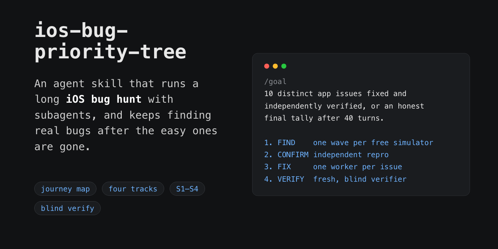

# ios-bug-priority-tree



An agent skill for [Claude Code](https://claude.com/claude-code) and [Codex](https://developers.openai.com/codex/cli) that runs an AI bug hunt on your iOS app in the Simulator, using subagents, and keeps finding real bugs after the easy ones are gone.

Point a few agents at an app and tell them to "find bugs" and you get one wave of easy findings, then diminishing returns, then a lot of tokens spent re-walking the same happy paths. This skill gives the orchestrator a testing method instead: map what users are actually trying to do, check that each action leaves the app in the state it should, and move into edge conditions only once the normal journeys have real depth. It also gives every agent the same definition of what counts as a bug.

It gives an agent orchestrator a method for exploratory bug hunting: what to test, in what order, how to rank what it finds, and when to stop. Your XCTest suite stays as it is.

For Android apps, use its sibling, [android-bug-priority-tree](https://github.com/ChrisThoma/android-bug-priority-tree). The method, ledger format and severity ladder are the same, so one goal loop can drive either.

## Install

With the skills CLI (works for Claude Code, Cursor, Codex, and others):

```bash
npx skills add ChrisThoma/ios-bug-priority-tree
```

Or clone the repo and copy the skill folder into your Claude Code skills directory:

```bash
git clone https://github.com/ChrisThoma/ios-bug-priority-tree.git
cp -r ios-bug-priority-tree/skills/ios-bug-priority-tree ~/.claude/skills/
```

For Codex, copy into `~/.codex/skills/` instead. Both hosts read the same `SKILL.md`; only the directory differs. For a single project, copy into `.claude/skills/` (or `.codex/skills/`) inside the repo.

## Quick start

The skill is a companion to a "find N distinct issues" goal loop. The loop owns builds, turns, commits and scheduling, and the skill supplies the testing method. Load it at the start of the hunt, before the first wave of finders.

In Claude Code, start a goal along these lines:

```text
/goal 10 distinct app issues fixed and independently verified, or an honest final tally after 40 turns.
Target: iPhone. First: load ios-bug-priority-tree; compose waves, prompts, budgets, map, coverage per it.
```

You can also invoke it directly with `/ios-bug-priority-tree` in Claude Code or `$ios-bug-priority-tree` in Codex.

<details>
<summary>The full goal prompt I use for iPhone hunts</summary>

It sets the target count and turn limit, the ledger format and the find, confirm, fix and verify loop, and leaves the testing method to the skill.

```text
10 distinct app issues fixed and independently verified, or an honest final tally after 40 turns.
Target: iPhone. One Target per ledger; never widen mid-hunt.
First: load ios-bug-priority-tree; compose waves, prompts, budgets, map, coverage per it.
Resume: for this Target keep ISSUES statuses/turn/coverage, verify commits, then process FIXED-UNVERIFIED, CONFIRMED, CANDIDATE. Never reconstruct from git. Another Target's ledger -> ISSUES-<target>.md. No match = turn 1. Turn = one cycle (apply results, one dispatch), not one completion.
Simulators: reuse, never duplicate. iPhone = SE-class SIM-A + large SIM-B; iPad = two sizes; named BugHunt-<App>-<Target>-A/-B. Each sim agent gets ONE recorded UDID. Assert/restore the skill baseline before wave 1 and after each worker.
APPMAP.md: structural only per skill; coverage/issue refs and build revisions go to ISSUES; keep dead leads, traps, fixtures.
HUNT.md: read before wave 1. Finders get Everyone + matching (forward); fixers get Fixers (forward); verifiers NEVER get HUNT, hypotheses, fix hashes/history. Never restamp; if stale per skill, say so once.
Agents: set model on every dispatch: sonnet; opus after a rejected fix or 3 stuck turns. You never write app code, drive sims, read source/diffs/build logs, or build; fixers build+test (own derivedData), commit, install, report diff summary + pass/fail. Every prompt, fixers too, carries the skill budget block; else reject. Evidence dir: git-ignored `.qa/hunt-<date>/`. Caps: finders 12 min, verifiers 8, fixers 25; use what they returned. While a fixer/verifier runs and the spawn rule holds, keep the free sim on the next uncovered journey. One dispatch delta, then stop; wake on completions only; no heartbeat under 30 min, agent listing, or waiting narration.
ISSUES.md: header `Turn N of 40 · <Target>`, then a `Slot | Name | UDID | Device` sims table. One labelled pipe line per issue: `#N | JID | description: | expected basis: | repro: | ratio: | impact: | evidence: | S1-S4 | track: | duplicate/root: | fix: | commit: | status:`, verdict first in status (CANDIDATE/CONFIRMED/FIXED-UNVERIFIED/VERIFIED/REJECTED/BLOCKED); duplicate/over-cap S4 = REJECTED + reason. No `|` in prose, no markdown table. Edit changed rows in place; never re-read the ledger. Then `## Coverage`: one `J<n> | coverage: | tested: | next:` row per journey, all `discovered` at turn 1, never a `status:` label. Then `## Builds`: `<slot> | build: | revision:` per install. No chronology/interim tallies.
Count distinct-root defects per skill: S1-S3, at most 2 S4.
Stop and report per skill "When to hunt and when to stop"; 10 is a ceiling, not a quota.
Protocol:
1. FIND: one skill wave (one sim finder/free sim + off-sim auditors). Each sim finder: one primary JID, map-read instruction, its coverage row, budget, own track only, <=10 prior lines. Spawn iff `CANDIDATE + CONFIRMED + FIXED-UNVERIFIED < 10 - VERIFIED`; at equality a free sim may take one uncovered core journey.
2. CONFIRM per skill: independent repro (confirm agent or finder 2/2). Harness/contamination causes -> map tooling caveats.
3. FIX: one worker/CONFIRMED issue, cheapest first; send description, repro, file pointers, APPMAP, Fixers priors. Worker commits `fix #N: <description>`; delegate smoke test; never patch. 3 stuck turns = BLOCKED/replace.
4. VERIFY: app code committed (ledger/map/HUNT edits may be pending). Fresh verifier gets blind-addendum inputs (one UDID), Target, budget. Exact repro + one named adjacent invariant. Quote verdict. BLOCKED = replace.
5. Verifier REJECTED = fix failed: CONFIRMED -> refix -> fresh verifier; two = BLOCKED/replace. CONFIRM-stage REJECTED is final.
Done: `10/10 VERIFIED` + hashes, or turn-40 tally, with category mix, false positives + causes, blocked root groups, coverage totals, residuals. Then append rejection causes, tar pits, verifier conditions to HUNT.md.
```

</details>

## How it works

1. Map the app in `APPMAP.md` as user journeys: goals, entry paths, prerequisites, expected outcomes, the state branches that matter, test data and reset commands. Screens are landmarks, not the unit of coverage.
2. Track hunt state in the ledger (`ISSUES.md`), not the map, so blind verifiers can read the map safely.
3. Test through four tracks. Track A completes journeys and checks data and persistence, Track B looks for state and consistency problems, Track C connects risky source to something a user would see, and Track D measures named journeys when a symptom calls for it.
4. Probe each action from baseline to settled result, check that other views agree and what survives a relaunch, then try cancel, retry, double tap, interruption and recovery.
5. Escalate into permissions, deep links, dates, locales, device conditions and disruptive tests only after normal journeys are covered.
6. Confirm every finding with an independent repro before it reaches a fixer, and verify every fix blind. Verifiers never see the source, the diff or git history, because a verifier that finds the fix will rubber-stamp it.
7. Stop when the hunt stops paying. After two rounds of only minor fixes, the report recommends shipping.

Most of the rules came out of watching runs go wrong: a verifier that spent 326 turns on a five-step repro, agents dismissing a return to the springboard as "a transition", phantom hangs caused by mistiming a tap rather than by the app.

Severity follows what happened to the user. S1 is catastrophic harm, S2 a failed task or harmful result, S3 a material UX failure, S4 pure polish. S1 through S3 count toward the goal; at most two S4s do, so finders can't farm alignment nits.

See [SKILL.md](skills/ios-bug-priority-tree/SKILL.md) for the full tree, including agent budgets, fixture requests and the escalation tiers. More about the skill: [individuation.dev/projects/ios-bug-priority-tree](https://individuation.dev/projects/ios-bug-priority-tree/).

## Requirements

Xcode command line tools (`xcrun simctl`), `sips`, and an MCP server that can drive a specific simulator. The tool names quoted in the skill are [ios-simulator-mcp](https://github.com/joshuayoes/ios-simulator-mcp)'s; swap in your own server's equivalents. `ffmpeg`, `idb`, `leaks` and `footprint` are only needed when a hunt escalates into motion, timing or memory work.

On Codex, subagents need the `multi_agent` feature, which is stable and on by default (`codex features list | grep multi_agent`). On Claude Code, no extra setup is needed. The `agents/openai.yaml` in the skill folder supplies Codex's display name and default prompt; Claude Code ignores it.

Use disposable simulators, sandbox accounts and synthetic data. Don't point destructive or repeated-action probes at production services. Re-check commands against the installed Xcode and simulator runtime before relying on them.

## License

[MIT](LICENSE)
